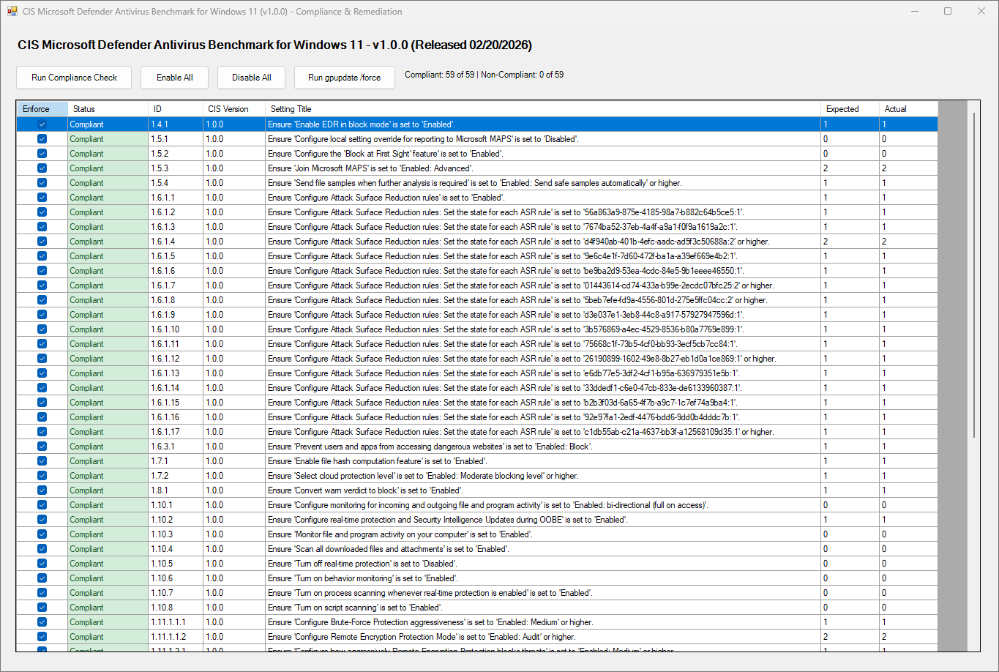

# CIS Microsoft Defender Antivirus Compliance & Remediation Tool for Windows 11

A professional, interactive Windows Forms PowerShell GUI designed to audit, manage, and remediate CIS benchmark compliance settings for Microsoft Defender Antivirus on Windows 11. 

---

## Features

- **Interactive Compliance Dashboard**: Scans and displays real-time compliance status (`Compliant` vs `Non-Compliant`) across comprehensive CIS benchmark checks.
- **Granular Row-Level Toggles**: Check or uncheck individual setting rows to dynamically enforce or revert configurations on the fly.
- **Batch Management**: Quick action buttons to **Enable All** or **Disable All** policy checks simultaneously.
- **Local GPO Persistence (`Registry.pol`)**: Automatically integrates with the `PolicyFileEditor` module to update the local Group Policy backing store so changes persist through `gpupdate /force` and system reboots.
- **Built-in `gpupdate /force` Action Button**: Execute a forced Group Policy refresh directly from the user interface with visual loading feedback.
- **Dynamic Window Scaling**: Responsive UI layout supporting window resizing and maximized states.

---

## Requirements

- **Operating System**: Windows 11
- **Privileges**: Administrator (Required to read/write system registry keys under `HKLM:\SOFTWARE\Policies` and modify local Group Policy files).
- **PowerShell**: Version 5.1 or higher.

---

## Installation & Usage

1. Download or copy the script file (e.g., `Defender_AV_Compliance_GUI.ps1`).
2. Open an elevated PowerShell prompt as Administrator and execute:
   ```powershell
   Set-ExecutionPolicy Bypass -Scope Process -Force
   .\Defender_AV_Compliance_GUI.ps1

## AFTER

